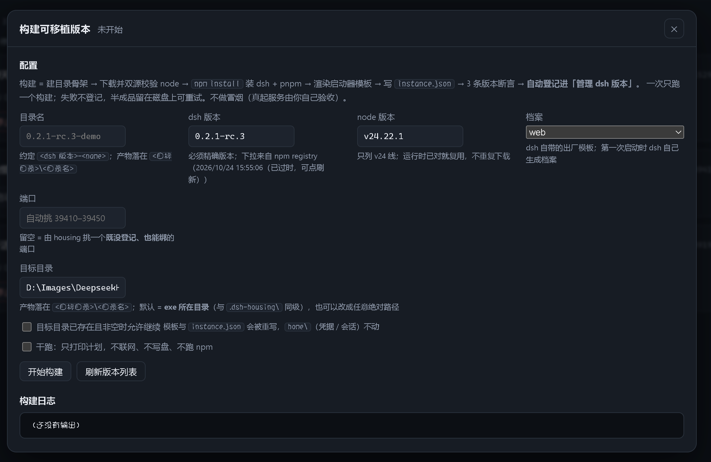
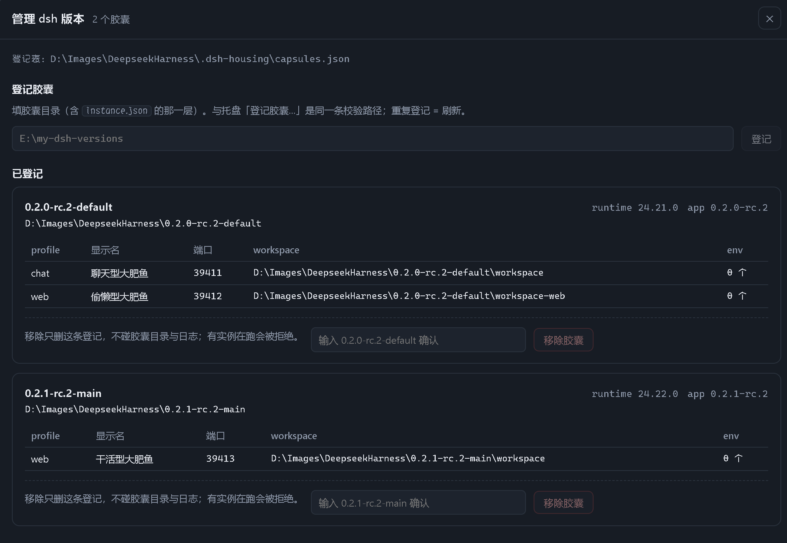
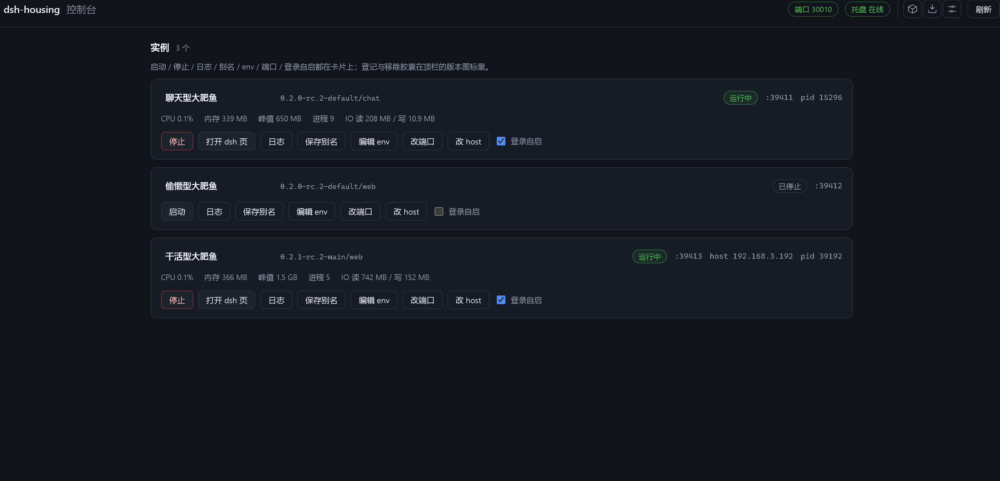

# dsh-housing

轻量、极简的 DeepSeek Harness 桌面启动器：单文件 exe（托盘 + 本地网页控制台），负责可移植 dsh 版本的构建，以及多个实例的启动、监控与停止。

## 使用

### 1. 打开启动器

把 `dsh-housing.exe` 放到一个可写的普通目录（建议空目录）并双击。这个目录会装下启动器的数据文件（`.dsh-housing\`）和之后构建出来的 dsh 版本；通知区域出现托盘图标，主进程在后台常驻，控制台页面会在浏览器里自动打开。

控制台顶栏会显示控制台端口与托盘状态，右侧三个图标依次是：管理 dsh 版本、构建可移植版本、设置。

### 2. 构建可移植版本

手上还没有 dsh 胶囊时才需要这步。点右上角的下载图标打开构建界面：



填好下面几项，点「开始构建」，进度和完整日志实时显示在下半屏：

- **目录名**：产物文件夹名，也是胶囊标识，习惯写成 `<dsh 版本>-<名字>`；
- **dsh 版本**：必须是精确版本号（下拉来自 npm registry，抓不到就手填）；
- **node 版本**：只列 v24 线，本地已有会直接复用、不重复下载；
- **档案**：dsh 自带的出厂档案模板，默认 `web`；
- **端口**：留空即可，启动器会挑一个既没登记、也能绑的空闲端口；
- **目标目录**：留空 = exe 所在目录。

构建要联网（npm registry 与 node 镜像），一次几分钟、约 1 GB 磁盘。窗口开着就别关，同一时间只能跑一个构建；勾「干跑」只打印计划，不联网也不写盘。构建成功的胶囊会自动登记进「管理 dsh 版本」；失败不登记，半成品留在磁盘上可以重试。

### 3. 管理 DSH 版本

点右上角的方块图标：



- **登记胶囊**：填胶囊目录（含 `instance.json` 的那一层）后点「登记」。一个胶囊按档案展开成多个实例，下面的表格能看到各实例的端口、workspace 和环境变量数量；对同一目录再登记一次 = 刷新。
- **移除胶囊**：按提示输入胶囊标识原文确认，再点「移除胶囊」。它只删登记记录，不碰胶囊目录与日志；有实例在跑会被拒绝，先停再删。

### 4. 日常操作



每张实例卡片对应一个「胶囊 × 档案」，卡片上能：

- 看状态、端口、PID，以及 CPU / 内存 / 峰值 / 进程数 / IO；
- 启动、停止，实例就绪后还能直接「打开 dsh 页」；
- 看日志（运行中读内存缓冲，停止后回读日志文件）；
- 改别名（留空保存 = 回到默认名）、实例级环境变量、端口、host；
- 勾「登录自启」，让 core 启动时自动拉起这个实例。

端口、host、环境变量都写进登记表，**下次启动该实例才生效**，实例运行中不允许改。

### 5. 兜底僵尸进程

```pwsh
dsh-housing.exe --stop-all
```

托盘或网页控制台挂掉时用：让已有的 core 停掉全部实例并退出。

## 其他功能

### webhook

实例就绪 / 停止 / 自行退出 / housing 启动四类事件各可配一条 HTTP POST，模板可用 `{time}` `{alias}` `{dsh_version}` `{dsh_profile}` `{local_url}` `{lan_url}`。注意 `{local_url}` 与 `{lan_url}` 带 dsh 的访问 token，只发给可信端点。

### 局域网访问控制台

控制台默认只绑回环。在设置里把控制台 host 改成 `0.0.0.0`，同网段的设备就能打开控制台页面（改完要重启 core）。这等于把「能启停本机实例」的页面暴露给局域网，URL 里的 token 是唯一凭证，风险自负。

### 登录自启动

在设置里启用后，程序会在任务计划里创建 `dsh-housing` 任务（登录后 15 s 以 `--role=core` 拉起 core），停用即删除。若机器上原有同用途的 `dsh-start` 任务，会先把它的定义备份到 `.dsh-housing\backup\` 再停用，停用本工具自启动时恢复。

### 自定义图标

替换 `assets/favicon.ico` 后重新构建即可：exe 图标、托盘图标和控制台 favicon 用的是同一份资源，换一处三处一起变。

## 构建

```pwsh
cargo build --release
```

产物：`target\release\dsh-housing.exe`，单文件、免安装。

前置条件：

- Windows + Rust stable，默认工具链 `stable-x86_64-pc-windows-msvc`；
- MSVC 链接器 + Windows SDK（`rc.exe`，用于把 `assets/favicon.ico` 编进 exe 当图标）；
- 前端是 vendor 的 Vue ESM + 手写 JS，随仓库提交并由 `include_dir!` 编译期内嵌 —— **构建不需要 node / npm**；
- 首次构建需要联网取 crate，之后可离线编译。

## 说明

本仓库按「发布即冻结」处理，不再加功能、不修 bug、不答使用问题，也不保证还能配合将来的 dsh 版本。

想要别的功能就 fork：代码自包含，`cargo build --release` 能直接编出完整产物，没有私有依赖，也没有需要另外下载的资源。

## 许可证

MIT，见 [`LICENSE`](LICENSE)。`crates/gui/web/vendor/` 里的 Vue 同为其 MIT 许可，见该目录的 `LICENSE-vue.txt`。
